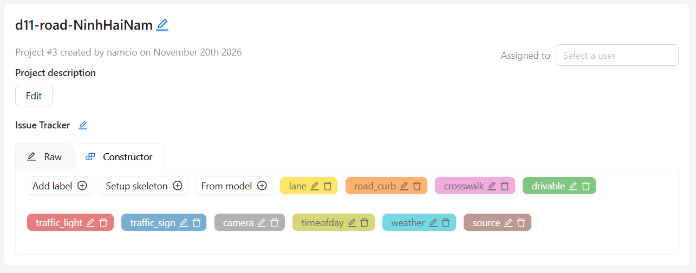
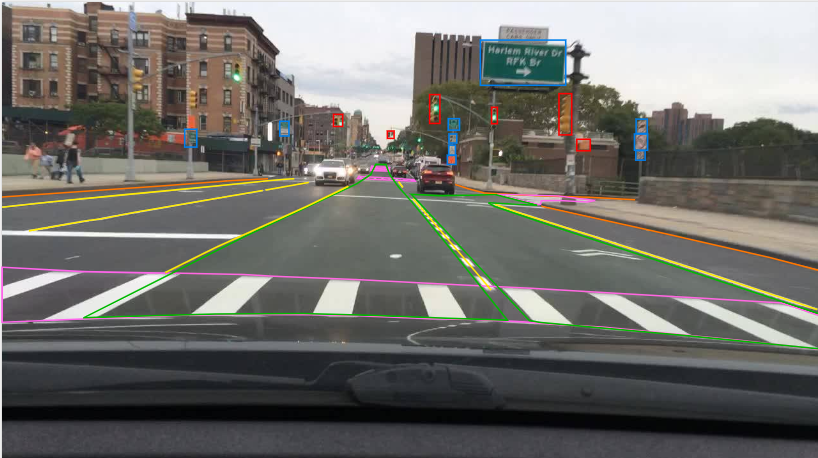
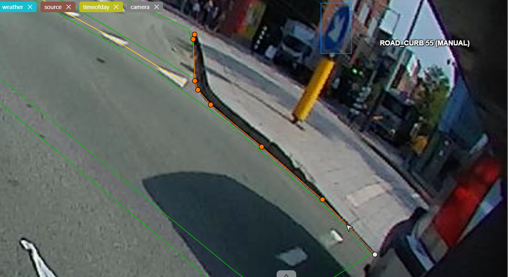
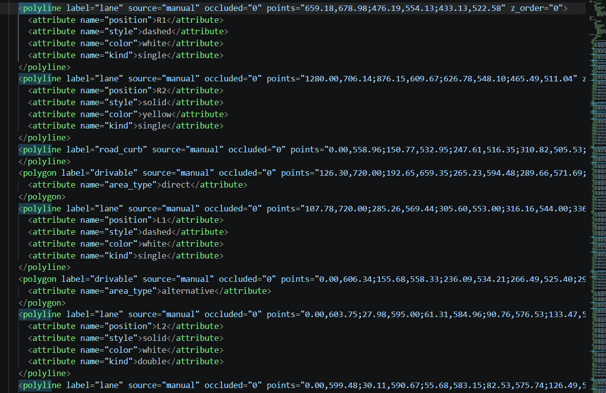

# Báo cáo cá nhân — Ngày 11

Họ tên: Ninh Hải Nam  
Mã học viên: 2A202603276  
Phiên bản CVAT (Help → About): cvat-2.81.0 (Docker)  
Guideline: Road v1.0  
Lần nộp (`revision` trong manifest): 2  
Thời điểm export (ngày giờ trên CVAT): 21/11/2026, 9h35  
Số lần nộp lại sau Rework: 1

## 1. Kiểm project

| Mục                   | Đúng như guideline Road v1.0? | Ghi chú                                                                                                                        |
| --------------------- | ----------------------------- | ------------------------------------------------------------------------------------------------------------------------------ |
| 6 label, đúng kiểu    | Có                            | Đối chiếu metadata export: lane/road_curb là polyline; crosswalk/drivable là polygon; traffic_light/traffic_sign là rectangle. |
| Thuộc tính và giá trị | Có                            | Các select và checkbox theo Road v1.0.                                                                                         |
| 4 tag ảnh             | Có                            | camera, timeofday, weather, source; mỗi ảnh có đủ tag trong ZIP cuối.                                                          |

Cách kết thúc polyline trên bản CVAT này: Bấm **N** để kết thúc polyline.  
Cách đặt tag ảnh trên bản CVAT này: Chọn công cụ Tag, đặt lần lượt camera, timeofday, weather, source; mở Details để kiểm tra giá trị.

## 2. Số lượng đã gán

| Task                         | Ảnh | lane | road_curb | crosswalk | drivable | traffic_light | traffic_sign |
| ---------------------------- | --: | ---: | --------: | --------: | -------: | ------------: | -----------: |
| front                        |  12 |   37 |        16 |        10 |       23 |            26 |           38 |
| front-extra (đã làm 4 / 4)   |   4 |   10 |         8 |         7 |        9 |             8 |           15 |
| fisheye                      |   8 |   11 |        27 |        13 |       13 |            10 |           17 |
| fisheye-extra (đã làm 4 / 4) |   4 |    0 |         6 |         6 |        4 |             1 |            2 |

## 3. Bảng ca khó

| Ảnh     | Nhãn                        | Phân vân giữa                                                | Đã chọn                                                 | Lý do                                                                       |
| ------- | --------------------------- | ------------------------------------------------------------ | ------------------------------------------------------- | --------------------------------------------------------------------------- |
| A05     | lane / road_curb / drivable | Có nên tự tạo L1/R1 khi mặt đường không có vạch sơn rõ không | Không vẽ lane; gán vùng drivable và curb nhìn thấy được | Không tạo vạch không có trong ảnh; nhờ coach xác nhận ngoại lệ thiếu L1/R1. |
| A04     | lane                        | Vạch vàng đôi là một hay hai lane shape                      | Một polyline đại diện, `kind=double`                    | Thuộc tính `kind` ghi nhận vạch đôi.                                        |
| B06–B08 | lane                        | Dùng L1/R1 hay `other` cho camera bên                        | `position=other`                                        | Guideline quy định lane ở fisheye trái/phải dùng `other`.                   |

## 4. Phiếu QC 1 nhận được

Bạn kiểm lô của tôi: **Đỗ Hoàng Anh**.  
Quyết định nhận được: **Rework**. Phiếu ghi 18 lỗi chính / 119 nhãn đã kiểm = 15,1%, vượt ngưỡng 5%. Có thêm hai trường hợp thiếu L1/R1 ở A07 và A10 đang chờ coach xác nhận.

| Mã lỗi |                    Số lỗi | Đồng ý?           | Đã sửa? |
| ------ | ------------------------: | ----------------- | ------- |
| QC1-02 | 0 xác nhận (+2 chờ coach) | Chờ xác nhận lead | Chưa    |
| QC1-04 |                         2 | không             | Chưa    |
| QC1-05 |                         3 | không             | Chưa    |
| QC1-07 |                         3 | không             | Chưa    |
| QC1-10 |                         1 | không             | Chưa    |
| QC1-11 |                         9 | không             | Chưa    |

## 5. Kiểm file export

| File                   | Mở lại được? | Số shape ảnh 1 (job / file) | Số shape ảnh 2 (job / file) | Tag camera có trong XML? |
| ---------------------- | ------------ | --------------------------- | --------------------------- | ------------------------ |
| ninhhainam-front.zip   | Có           | A01: 10 / 10                | A02: 8 / 8                  | Có (`front`)             |
| ninhhainam-fisheye.zip | Có           | B01: 6 / 6                  | B02: 13 / 13                | Có (`fisheye_front`)     |

Hai ZIP chứa `annotations.xml`. Đã chạy `road_check lint`; ZIP đọc được và có 16 ảnh front, 12 ảnh fisheye.

## 6. Ảnh chụp màn hình

Chèn ảnh chụp ngay dưới từng dòng tương ứng:

1. Tab **Labels** của project. 
2. Một ảnh camera trước đã gán đủ lane, drivable và đèn/biển (có thể dùng A08). 
3. Một ảnh fisheye đã gán, phóng to đoạn polyline cong (có thể dùng B03 hoặc B05). 
4. Mở `annotations.xml` trong ZIP và chụp đoạn có `<polyline label="lane">`. 

## 7. Tự đánh giá

Mục tôi cần để ý nhất là **QC1-11 (`edge_zone`)**: lint còn gợi ý một số box ở rìa ảnh fisheye. Lần sau tôi sẽ kiểm tâm từng box theo ngưỡng 80% bán kính trước khi export, thay vì chỉ nhìn box có ôm sát đối tượng hay không.

Một lỗi position lane ở camera fisheye bên có thể làm model học nhãn L/R cho góc nhìn không phù hợp. Tôi đã rà lại lane ở B06–B08 và dùng `position=other` theo guideline, để nhãn huấn luyện nhất quán giữa các camera.

## 8. (Tùy chọn, buffer) Từ polyline đến đích row-anchor

| y               | 720 | 680 | 640 | 600 | 560 |
| --------------- | --: | --: | --: | --: | --: |
| x của chúng tôi |     |     |     |     |     |
| x của bạn kia   |     |     |     |     |     |

Phần này tùy chọn; chỉ điền nếu làm hoạt động row-anchor.
